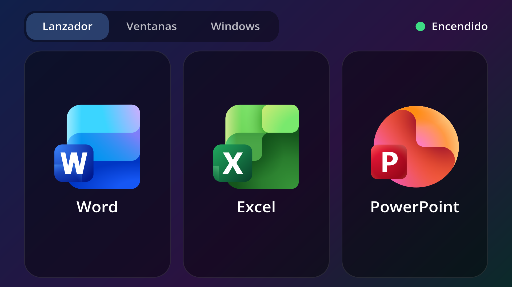
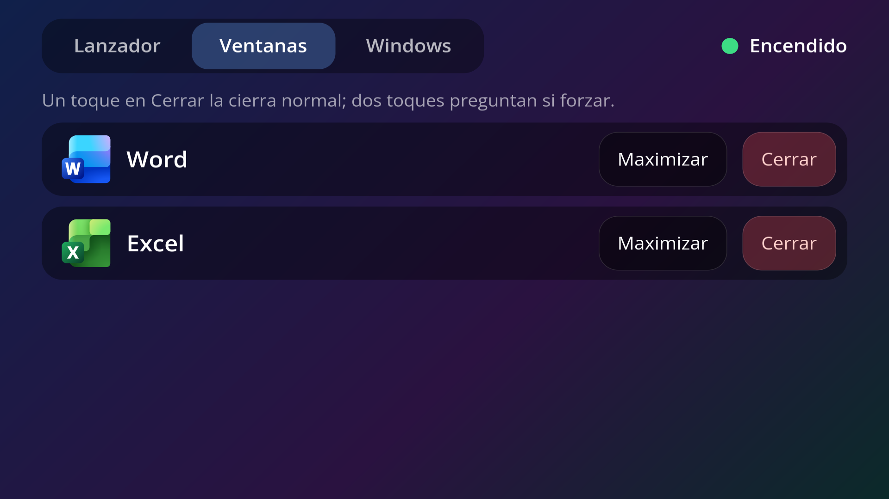
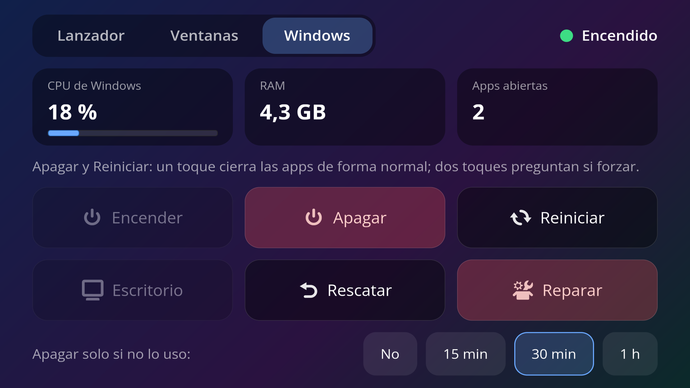

# win-control

Comando `win` para encender, apagar y usar el Windows de [WinApps](https://github.com/winapps-org/winapps) (contenedor Docker con `dockur/windows`), y un complemento de [GlassPad](https://github.com/kan0p/asus-screenpad-linux) para manejarlo desde la ScreenPad.

La idea: Windows solo ocupa RAM mientras lo usas. Al abrir Word, Excel o PowerPoint desde el menú, `win` lo enciende y espera a que esté listo; cuando no lo usas, lo apagas con `win off` o dejas que se apague solo.

## Capturas

Complemento de la ScreenPad (GlassPad), con tres páginas que se cambian deslizando el dedo o con las pestañas:

| Lanzador | Ventanas | Windows |
|---|---|---|
|  |  |  |

## Requisitos

- WinApps instalado para el usuario (`setup.sh --user`) con `WAFLAVOR="docker"`.
- Contenedor llamado `WinApps` (el `compose.yaml` de WinApps ya lo nombra así).
- Usuario en el grupo `docker`.
- Para `win presentar`: `sdl-freerdp3` (viene en el paquete `freerdp` 3) y, para compilar el arreglo de pantalla completa, `gcc` y SDL3 con sus cabeceras.
- Opcional: GlassPad 0.9.1 o posterior para el complemento.

## Instalación

```sh
git clone https://github.com/kan0p/win-control
cd win-control
./install.sh
```

No usa root. Crea un enlace `~/.local/bin/win`, hace que los accesos de Word, Excel, PowerPoint y el escritorio de Windows del menú pasen por `win`, agrega `-gfx` a `RDP_FLAGS` en `winapps.conf`, compila `sdl/pantalla-completa.c` en `~/.local/lib/win-control/` y, si GlassPad está instalado, agrega el complemento **Windows**.

Desinstalar: `./install.sh --desinstalar`

## Uso

```
win                    estado: encendido/apagado, RAM y apps abiertas
win on                 enciende Windows y espera a que esté listo
win off [-f]           cierra las apps (preguntan si guardar) y apaga; -f fuerza
win restart [-f]       igual, pero reinicia
win excel [archivo]    abre Excel (enciende Windows si hace falta)
win word  [archivo]    abre Word
win ppt   [archivo]    abre PowerPoint
win apps               apps de Windows abiertas
win cerrar [-f] <app>  cierra una app (p. ej. EXCEL); -f fuerza sin guardar
win cerrar [-f] todas  cierra todas las apps
win maximizar <app>    maximiza la ventana de una app (p. ej. WINWORD)
win presentar          escritorio a pantalla completa en el notebook y, si está extendido, el
                       proyector (vista del moderador de PowerPoint); el lanzador abre las apps dentro
win escritorio         escritorio de Windows en una ventana (al cerrarlo se reinicia)
win desconectar        cierra el escritorio abierto; Windows se reinicia
win rescatar           si las ventanas se congelaron: escritorio sobre tu sesión, sin perder nada
win reparar            reinicia Windows si algo quedó trabado
win auto <min>|off     apaga Windows tras <min> minutos sin apps abiertas
win log [n]            registro de win, del agente y de FreeRDP (últimas n líneas)
win logs               registros del contenedor en vivo
```

- Solo corre una orden de apagar o reiniciar a la vez; las repetidas se rechazan. Pedir `-f` mientras un apagado normal espera a que guardes lo convierte en forzado.
- Los pedidos repetidos (el mismo archivo o la misma app en menos de 3 s) se descartan; dos documentos distintos del mismo programa se abren en ventanas separadas.


### Cómo abre las apps

Con Windows 11 24H2 y FreeRDP 3, una sesión RemoteApp a la que se reconecta ya no muestra ventanas, y WinApps abre una conexión nueva por app que reconecta a la misma sesión. Por eso `win` no usa el lanzador de WinApps para las apps:

- Abre **una sola conexión** (en su propio scope de systemd, para que sobreviva aunque se reinicie quien la abrió) con un agente invisible, `windows/agente.ps1`, que corre con `conhost --headless`.
- El agente recibe los pedidos por una unidad propia y pequeña (`\\tsclient\win`, que es `~/.local/state/win`) y abre cada app dentro de esa sesión, así que puedes tener varias abiertas a la vez.
- Cuando cierras la última app, el agente cierra la sesión (`logoff`) y la siguiente empieza limpia. También la cierra si la conexión se corta. Antes de conectar, `win` espera a que una sesión cortada termine de cerrarse y elimina conexiones huérfanas; si aun así el agente no arranca, reinicia Windows y reintenta.
- Los archivos de tu carpeta personal se abren por la carpeta compartida de Samba del contenedor (`\\host.lan\Data`), no por la redirección de unidades de RDP, que puede quedar ocupada minutos mientras Office la recorre. Los pendrives (`/run/media`) siguen por `\\tsclient\media`.
- Requiere `-gfx` en `RDP_FLAGS` (el instalador lo agrega).

Mientras abre, la notificación "Abriendo Excel…" se queda hasta que la ventana aparece (`ventanas.py` lee las ventanas de XWayland), y en la ScreenPad el mosaico muestra una ruedita con la etapa.

El escritorio completo deja la sesión en un estado que rompe RemoteApp, por eso `win escritorio` reinicia Windows al cerrarse. Si algo queda trabado, `win reparar` cierra todo y reinicia Windows.

### Escritorio a pantalla completa y presentaciones

Las apps sueltas usan solo la pantalla principal (`/monitors:0` en Thincast): con un proyector extendido, Thincast en Wayland calcula mal las posiciones y las ventanas saltan y no reciben clics. Por eso no conviene arrastrarlas a otra pantalla.

Para presentar con la vista del moderador de PowerPoint está `win presentar` (el botón **Escritorio** del complemento):

- Abre el escritorio completo con `sdl-freerdp3` en Wayland nativo, una ventana a pantalla completa por pantalla: el notebook y cada pantalla extendida, menos la ScreenPad. Con el proyector duplicado o sin proyector, usa solo el notebook. xfreerdp3 no sirve para esto: en XWayland dibuja todo en una sola ventana, que COSMIC muestra en una sola pantalla.
- Antes de abrir, acomoda las pantallas con `cosmic-randr` para que no se traslapen (FreeRDP las rechaza).
- `sdl/pantalla-completa.c` (cargado con `LD_PRELOAD`): FreeRDP pide pantalla completa antes de mostrar cada ventana y COSMIC, en ese momento, ignora en qué pantalla va; la librería repite el pedido cuando la ventana ya está visible.
- Va sin `-gfx` (con él, SDL no dibuja nada) y con `FREERDP_WLROOTS_HACK=force` (sin él, en COSMIC lee 64×64 como tamaño de pantalla).
- El agente también corre ahí, en modo escritorio (no cierra la sesión): lo arranca un acceso directo de Inicio de Windows que crea el agente de las apps sueltas la primera vez. Con el escritorio abierto, `win word`, `win excel`, `win ppt`, la página Ventanas, cerrar y maximizar funcionan dentro de él. Usa su propia carpeta, `~/.local/state/win/escritorio`.
- Las pantallas se leen al abrir: conecta el proyector antes. Si lo cambias con el escritorio abierto, desconecta y vuelve a abrirlo.
- Se cierra con `win desconectar` (o cerrando sesión en Windows); igual que el escritorio en ventana, al cerrarse reinicia Windows.

### Agregar más apps de Windows

Instala el programa dentro de Windows (`win escritorio`) y luego ejecuta `winapps-setup --user --add-apps`. Las apps nuevas aparecen en el menú y en *Todas las apps* de GlassPad.

### Apagado automático

`win auto 30` instala un temporizador de systemd del usuario (`win-auto.timer`) que revisa cada 2 minutos. Si pasan 30 minutos sin ninguna app de Windows abierta, apaga el contenedor y avisa con una notificación. `win auto off` lo desactiva.

### Cliente RDP: FreeRDP o Thincast

`win cliente thincast` usa [Thincast Remote Desktop Client](https://www.thincast.com/en/products/client) (Flatpak `com.thincast.client`) para las apps sueltas; `win cliente freerdp` vuelve a xfreerdp3. Con COSMIC, xfreerdp3 3.32 se congela a veces en modo RemoteApp al aparecer una ventana nueva (deja de leer la conexión), y Thincast no. `win` le da a Thincast acceso a Wayland y a la carpeta del agente, y omite la pregunta por el certificado (la conexión es solo a 127.0.0.1).

En Wayland, Thincast dibuja las ventanas sin marco: se mueven con **Super + arrastrar** y se maximizan con los atajos de COSMIC. Como esas ventanas no son de X11, los títulos para el indicador de carga los informa el agente desde Windows.

El escritorio completo y `win rescatar` siguen usando xfreerdp3, que en ese modo es estable.

El agente marca `host.lan` (la carpeta compartida por Samba) como intranet local en el usuario de Windows. Sin eso, Windows la trata como internet: Office abre los archivos en Vista protegida y bloquea las macros. Con intranet, las macros muestran la barra "Habilitar contenido" de siempre.

### Registros

Todo queda en `~/.local/state/win/`:

- `win.log`: cada orden, conexiones lanzadas o eliminadas, esperas, reparaciones automáticas, cuándo apareció cada ventana y los errores.
- `agente.log`: lo que hizo el agente dentro de Windows. También se guarda en el disco de Windows (`%LOCALAPPDATA%\win-control`), que no depende de la unidad compartida.
- `agente-anterior.txt`: el último paso que hacía el agente en la sesión anterior y sus últimas líneas; si se colgó, dice dónde.
- `freerdp.log` y `freerdp.anterior.log`: la salida de FreeRDP de la conexión actual y de la anterior.

`win log` muestra lo más reciente de todo junto.

## Complemento de GlassPad

Página **Windows** en la ScreenPad, con tres secciones que se cambian deslizando el dedo en horizontal (GlassPad con `api.al_deslizar`) o tocando las pestañas:

- **Lanzador**: Word, Excel y PowerPoint en grande. Si Windows está apagado, lo enciende. Mientras abre, el mosaico muestra una ruedita con la etapa hasta que la ventana aparece de verdad.
- **Ventanas**: apps abiertas con **Maximizar** y **Cerrar** (un toque cierra normal y Windows pregunta si guardar; dos toques preguntan si forzar).
- **Windows**: CPU, RAM y apps abiertas; **Encender**, **Apagar**, **Reiniciar** (un toque cierra las apps de forma normal; dos toques preguntan si forzar), **Escritorio** (abre `win presentar`; con el escritorio abierto pasa a **Desconectar**), **Rescatar** (si las ventanas se congelan, abre el escritorio sobre tu sesión sin perder nada) y **Reparar** (reinicia Windows, pide confirmación); y el apagado automático. Mientras una orden está en curso no se puede repetir.

CPU y RAM se leen del cgroup del contenedor (`/sys/fs/cgroup`), sin `docker stats`: la consulta de estado tarda ~0,2 s.

`win` no muestra notificaciones de progreso: el avance se ve en la ScreenPad. Solo un error al abrir desde el menú o desde un archivo aparece unos segundos como notificación.

## Avisos

- Necesitas tus propias licencias de Windows y de Microsoft 365. Este proyecto no incluye, descarga ni activa ninguna licencia; Office se activa iniciando sesión con tu cuenta.
- Microsoft, Windows, Office, Word, Excel y PowerPoint son marcas de Microsoft. Este proyecto no está afiliado a Microsoft.
- [WinApps](https://github.com/winapps-org/winapps) y [dockur/windows](https://github.com/dockur/windows) tienen sus propias licencias; este repositorio no incluye su código.
- [Thincast Remote Desktop Client](https://www.thincast.com/en/products/client) es software de terceros con sus propios términos de uso.

## Licencia

GPL-3.0-or-later. Ver [LICENSE](LICENSE).
